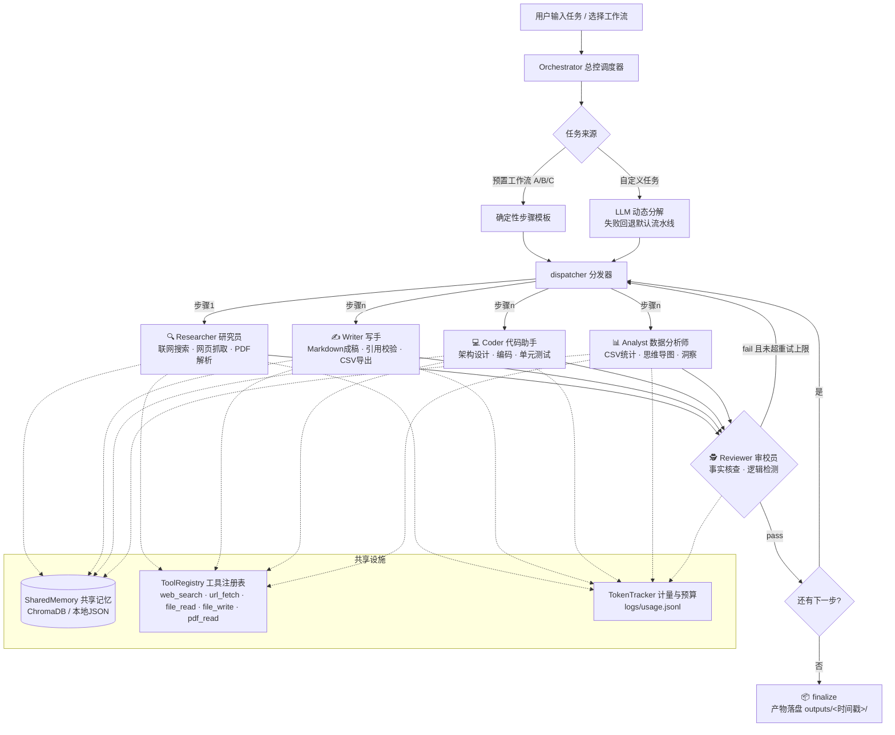

# AI Agent Team · 多智能体协作实验

五个专家角色（研究员 / 写手 / 审校员 / 代码助手 / 数据分析师）在总控调度器的指挥下
接力完成复杂任务：任务分解 → 逐步执行 → 自动审校 → 不通过自动重做 → 产物落盘。

技术栈：**LangChain（模型与消息）+ LangGraph（状态机编排）**。
> 框架选型说明：原需求提到 LangChain + AutoGen 双框架；同时引入两个
> 编排内核会带来依赖冲突与行为不可预测性，因此采用同属 LangChain 生态、专为
> "接力 + 回流"式流水线设计的 LangGraph 作为唯一编排内核，更安全稳定。

---

## 1. 系统架构



### 记忆（Memory）接口规范

| 层级 | 实现 | 说明 |
|---|---|---|
| 短期记忆 | `core/state.py` AgentState | 一次任务内所有节点共享（LangGraph 状态） |
| 长期记忆 | `core/memory.py` SharedMemory | 跨任务沉淀；`write/read/search/snapshot` 四个方法 |
| 后端 | ChromaDB（配置 `CHROMA_HOST`）/ 本地 JSON（默认降级） | 未装 chromadb 也能跑 |

### 工具（Tools）接口规范

所有工具继承 `core/base.py::BaseTool`：输入为基本类型参数，
输出统一为 `ToolResult(ok, text, meta)`，**失败不抛异常**（`ok=False` + 说明文本），
尽量避免工具故障中断整条流水线。注册到 `ToolRegistry` 后按名字调用。

---

## 2. 快速开始（3 条命令）

```bash
./startup.sh                  # 创建虚拟环境 + 安装依赖 + 生成 .env
vi .env                       # 填写 OPENAI_API_KEY（必填）；TAVILY_API_KEY（可选，开联网搜索）
source .venv/bin/activate && python main.py
```

> `.env` 示例默认指向 DeepSeek（`https://api.deepseek.com/v1` + `deepseek-chat`），
> 也可换成通义千问 / 智谱GLM / OpenAI 等任何 OpenAI 兼容接口。

## 3. 使用方法

### 交互式（推荐第一次用）

```bash
python main.py          # 菜单选择：A 知识萃取 / B 代码开发 / C 内容创作 / T 自定义
```

### 命令行直跑

```bash
# 工作流 A：知识萃取（输入 URL / PDF 路径 / 主题均可）
python main.py --workflow A --input "https://example.com/article"

# 工作流 B：代码开发
python main.py --workflow B --input "做一个命令行TODO应用，支持优先级与到期提醒"

# 工作流 C：内容创作
python main.py --workflow C --input "AI Agent 在中小企业的落地实践"

# 自定义任务（规划器自动分解流水线）
python main.py --task "调研 LangGraph 最新特性，对比 AutoGen，输出选型报告"
```

### 三条预置工作流

| 工作流 | 流水线 | 产物 |
|---|---|---|
| **A 知识萃取** | 研究员(URL/PDF/搜索) → 分析师(思维导图+洞察) → 写手(速览+Anki卡片) | `research_notes.md`、`mindmap.md`、`anki_cards.md` + `anki_cards.csv`（可直接导入 Anki） |
| **B 代码开发** | 代码助手(架构) → 代码助手(实现+pytest) → 写手(README) | `architecture.md`、`implementation.md` + `code/` 下真实代码文件、`readme.md` |
| **C 内容创作** | 研究员(素材) → 写手(初稿) → 写手(终稿+配图建议+发布文案) | `material.md`、`draft.md`、`publish_pack.md` |

每个步骤完成后 **reviewer 自动审校**：fail 且未超 `defaults.max_retries`（默认2次）
会自动带着审校意见重做该步骤；通过则推进下一步。

### 产物与日志

```
outputs/<时间戳>_<工作流>/
├── artifacts/          # 每个步骤的 Markdown 产物
├── code/               # 工作流B产出的真实代码文件
├── anki_cards.csv      # 工作流A的 Anki 导入文件
└── summary.json        # 任务摘要（计划/审校结论/token消耗）

logs/usage.jsonl        # 每次 LLM 调用的 token 记账（monitor 数据源）
logs/tasks.jsonl        # 任务/阶段/审校/重试事件流水
```

### 监控

```bash
python monitor.py             # 输出一次当前状态
python monitor.py --watch     # 每 5 秒自动刷新
```

展示：各 Agent 的调用次数 / 输入输出 token / 合计，`TOKEN_BUDGET` 预算进度条，
以及最近的任务事件流水（含审校裁决与重试）。

## 4. 自定义 Agent 教程（3 步）

以新增"翻译官 translator"为例：

**第 1 步** —— 在 `agent_config.yaml` 添加角色配置：

```yaml
agents:
  translator:
    temperature: 0.2
    system_prompt: |
      你是"翻译官"，在中英互译间保持术语一致、语气自然。
      输出仅含译文，保留原文的 Markdown 结构与引用编号。
```

**第 2 步** —— 新建 `agents/translator.py` 并继承 `BaseAgent`：

```python
from typing import Any, Dict
from agents.base_agent import BaseAgent
from core.state import AgentState

class TranslatorAgent(BaseAgent):
    name = "translator"
    description = "中英互译，保留格式与引用"

    def run(self, state: AgentState, step: Dict[str, Any]) -> Dict[str, Any]:
        context = self.build_context(state.get("artifacts", {}), step.get("input_from"))
        text = self.client.invoke(self.system_prompt,
                                  f"## 任务\n{step.get('task')}\n\n## 原文\n{context}")
        self.memory.write(self.name, step.get("output_key", "translation"), text)
        return {"artifact": text, "files": []}
```

**第 3 步** —— 在 `agents/__init__.py` 注册：

```python
from agents.translator import TranslatorAgent
AGENT_REGISTRY["translator"] = TranslatorAgent
```

之后即可在工作流步骤或自定义任务中使用 `"agent": "translator"`。
（自定义工具同理：继承 `core/base.py` 的 `BaseTool`，在 `tools/__init__.py` 注册。）

## 5. Docker 部署（可选基础设施）

```bash
./startup.sh --with-docker     # 或：docker compose up -d
```

* **Redis**（缓存扩展位）：`127.0.0.1:6379`，healthcheck 齐全；
* **ChromaDB**（向量记忆）：`127.0.0.1:8000`；
  启用后编辑 `.env` 设置 `CHROMA_HOST=127.0.0.1`，重启任务即可自动切换语义检索记忆。

两个端口都只绑定 `127.0.0.1`，不暴露到局域网；不启动容器系统也能跑
（记忆自动降级为本地 JSON 文件）。

## 6. 配置参考（agent_config.yaml / .env）

| 配置 | 位置 | 说明 |
|---|---|---|
| 每角色 model / temperature / system_prompt | `agent_config.yaml` | 独立调优；未指定 model 时用 `defaults.model` |
| `DEFAULT_MODEL` | `.env` | 覆盖 `defaults.model`，换模型最方便的入口 |
| `OPENAI_BASE_URL` | `.env` | 任意 OpenAI 兼容端点 |
| `TAVILY_API_KEY` / `SERPAPI_API_KEY` | `.env` | 联网搜索；都不配则降级为离线模式 |
| `TOKEN_BUDGET` | `.env` | token 总预算，超出自动终止（默认 0 = 不限） |
| `CHROMA_HOST` / `CHROMA_PORT` | `.env` | 向量记忆后端 |
| `max_retries` / `max_steps` | `agent_config.yaml` | 审校重试上限 / 步骤数上限 |

## 7. 安全与隐私设计

* **密钥安全**：API Key 只存在于 `.env`（已被 `.gitignore` 排除），项目使用环境变量读取密钥；请勿在任务输入、代码或日志中填写真实密钥；
* **文件沙箱**：文件工具只能读写项目目录内路径，`.env`、`*.key`、`id_rsa`、`.git`、`.ssh`
  等敏感路径被黑名单拦截，降低误读敏感文件的风险；
* **SSRF 防护**：`url_fetch` 拒绝 localhost / 内网段 / 云元数据地址；
* **Token 预算**：`TOKEN_BUDGET` 超限立即熔断，防止失控消耗；
* **遥测默认关闭**：`LANGCHAIN_TRACING_V2=false`，数据全部留在本机
  （`outputs/` 与 `logs/`）；唯一外发请求是 LLM 推理与（配置后的）搜索 API。

## 8. 常见问题

**Q: 不配置搜索 Key 能跑吗？**
能。研究员会注明"内容未经联网核实"，流水线照常完成。

**Q: 审校一直 fail 会死循环吗？**
不会。每步最多重做 `defaults.max_retries`（默认 2）次，之后放行并记录问题；
LLM 审校输出无法解析时默认放行（fail-open），保证流水线永不错锁。

**Q: 怎么换模型？**
改 `.env` 的 `DEFAULT_MODEL` 与 `OPENAI_BASE_URL` 即可全局部署；
或在 `agent_config.yaml` 里给单个角色配不同模型（如规划器用强模型、写手用快模型）。

**Q: 测试怎么跑？**
`python -m pytest tests -q`——离线假模型冒烟测试，不需要任何 API Key。

## 离线检查与运行边界

`python main.py --help` 不需要模型密钥或第三方依赖。`python main.py --check` 只检查模块是否存在，不读取 `.env`、不联网、不调用模型。已有 `python -m pytest tests -q` 使用假模型，但需要先安装测试与运行依赖；测试徽章不代表当前机器已通过本次验证。真实任务会调用配置的模型服务，输出仍需人工核验。
